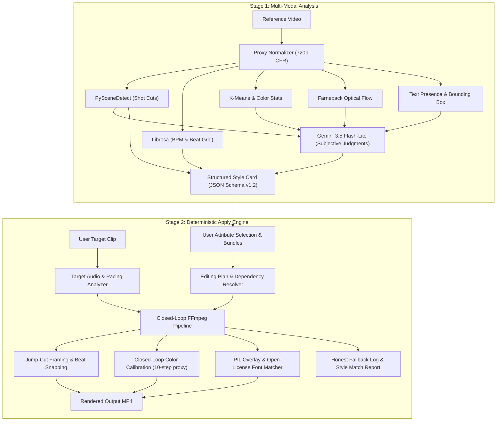

# Style Transfer Planner 🎬

[](https://github.com/cardboard-internship/style-transfer-planner/actions/workflows/tests.yml)
[](https://www.python.org/)
[](LICENSE)

An agentic video editing intelligence system addressing **Cardboard's Hard Problem #6: Style References**. Ingests a short reference video, decomposes it into actionable style attributes (pacing, rhythm, color grade, typography, transitions), lets users choose what to borrow, reproduces them with FFmpeg, and logs fallbacks transparently when an asset or effect cannot be copied.

---

## Architecture Overview



---

## How Each Attribute Is Measured

| Attribute | Objective Measurement (Code) | Subjective Judgment (Gemini) |
| :--- | :--- | :--- |
| **Pacing** | Shot boundaries, cuts/min, average shot length, pacing shape | Scene narrative role (hook vs body vs payoff) |
| **Audio Rhythm** | Librosa BPM, beat grid, energy peaks, beat-sync score | Genre hint |
| **Color Grade** | 5-point stats (saturation, contrast, brightness, warm shadows/highlights) | Aesthetic grade name (e.g. `teal-orange`, `matte`) |
| **Transitions** | Single-frame pixel delta test (hard cut vs soft transition) | Transition categorization (`zoom punch-in`, `crossfade`) |
| **Text / Typography** | Caption change rate (Hz), spatial bounding boxes, case | Treatment description, font category classification |
| **Camera & Layout** | Farneback optical flow magnitude | Camera movement (`push-in`, `pan`), composition layout |

---

## Quick Start & Local Setup

### 1. Requirements
- Python 3.12+ (tested on Python 3.12 and 3.14).
- FFmpeg and FFprobe installed and on your system `PATH` (>= 5.1).

### 2. Installation
```powershell
# Clone the repository
git clone https://github.com/kubrick-G/style-transfer-planner.git
cd style-transfer-planner

# Create and activate virtual environment
python -m venv .venv
.\.venv\Scripts\Activate.ps1   # macOS/Linux: source .venv/bin/activate

# Install dependencies
pip install -r requirements.txt
pip install -r requirements-dev.txt
```

### 3. Running the Test Suite
```powershell
python -m pytest -q
```
Runs 180+ offline tests covering all analysis stages, closed-loop calibration, font resolving, and Streamlit AppTest flows with synthetic ground truth.

### 4. Running the Web Application
```powershell
python -m streamlit run app.py
```
Open [http://localhost:8501](http://localhost:8501) in your browser.

---

## First-Run Experience (Zero-API Demo)

The repo bundles rights-cleared synthetic demo references and target clips in `data/demo/`. You can immediately:
1. Select a pre-analyzed demo card (`demo_fast_cuts (demo)`).
2. Select a target clip (`demo_target_speech.mp4 (demo)`).
3. Select attributes: Pacing, Audio Rhythm, Transitions, Color, and Text.
4. Click **Apply Style**: renders in ~9s with zero Gemini calls required.

---

## CLI Usage

### Analyze a reference video:
```bash
python scripts/analyze_cli.py path/to/reference.mp4 [--out-dir outputs] [--no-cache]
```

### Apply style to a target clip:
```bash
python scripts/apply_cli.py \
  --reference outputs/demo_fast_cuts.stylecard.json \
  --target data/demo/clips/demo_target_speech.mp4 \
  --apply pacing,audio_rhythm,transitions,color,text \
  --out outputs/result.mp4 \
  --debug
```

### Run headless smoke test:
```bash
python scripts/smoke_test.py --headless-only
```

---

## Public-Mode Hardening & Deployment

When deploying to Streamlit Community Cloud or Docker, setting `STP_PUBLIC_MODE=1` activates:
- **Clip length limits** (`STP_MAX_CLIP_S=30`) and upload size caps (`STP_MAX_UPLOAD_MB=50`).
- **One heavy job at a time** via non-blocking process semaphores.
- **Hourly cleanup** automatically unlinking uploads and renders older than 1 hour.
- **Daily Gemini usage cap** tracking request attempts with UTC midnight rollover.
- **Visible Privacy Notice** informing visitors that footage is deleted within 1 hour.

See [docs/DEPLOY.md](docs/DEPLOY.md) for step-by-step Streamlit Cloud and Hugging Face Spaces deployment instructions.

---

## Verified vs Not Verified

### Verified:
- **Offline ground-truth test suite**: 180+ tests passing offline without network or API dependencies.
- **Closed-loop color calibration**: Measures real rendered proxy frames across 10 iterations to eliminate non-linear HSV cross-talk.
- **Single-frame transition reconciliation**: Code overrules Gemini if pixel differences contradict an abrupt cut.
- **AppTest end-to-end flows**: Automated UI tests verifying zero-key path, parameter toggles, dependency warnings, and result rendering.
- **Smoke test**: Headless 5-attribute transfer verified in ~9.15s.

### NOT Verified / Known Gaps:
- **Live Gemini caption sync on raw uncleaned speech**: On real clip `lv_0_20231212164716.mp4`, audio energy lag correlation gave 0.21 confidence. Ground-truth word timings are logged in `eval/sync_truth/` awaiting human verification.
- **Kinetic text animation**: Pop/scale and word-by-word animation are parsed and logged in the fallback log as instant swaps.
- **Multi-panel layout transfer**: Split-screen and picture-in-picture references are reported in the plan rather than rebuilt with FFmpeg.
